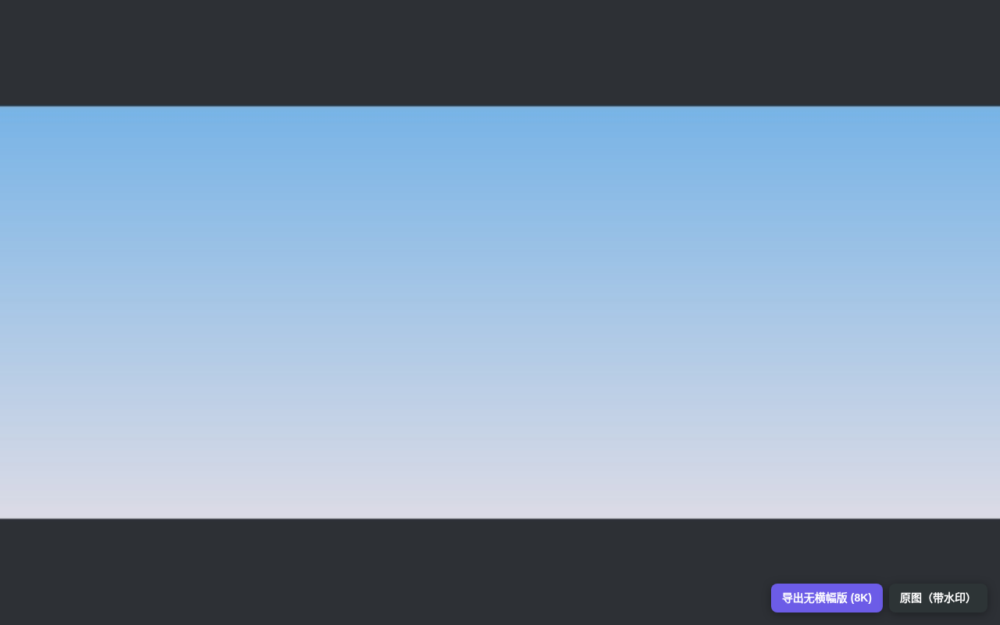
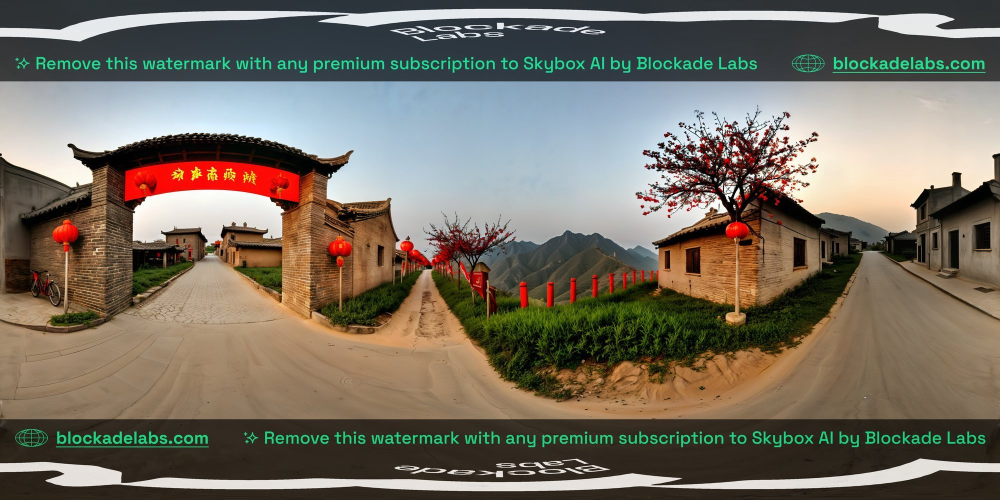

# Skybox Exporter

Export your [Skybox AI](https://skybox.blockadelabs.com) 360° panoramas as full-resolution images (8K equirectangular JPG) — including on free accounts, which have no official download button.

[中文说明](./README.zh-CN.md)



## Features

- One-click export buttons injected into Skybox pages (generator pages and public `/e/<hash>` share pages):
  - **No-banner export**: crops the official watermark banners locally (top/bottom, measured 17% each on 8K images), JPEG q95
  - **Original export**: byte-identical download of the officially served image (watermark preserved)
- Toolbar popup shows the current skybox card (thumbnail / title / status) with the same export options
- Downloaded files are named after the skybox title

| Original (with watermark banners) | No-banner crop |
|---|---|
|  |  |

## How It Works

The Skybox web viewer must load the full panorama into your browser to render it. This extension detects that image URL in-page — parsing the SSR-injected RSC `initialData` on share pages, or reusing the frontend's own `/api/proxy` API on app pages — and downloads the file directly. **No canvas screenshots, no quality loss** (up to 8192×4096). Cropping is done locally in your browser via canvas.

## Install (Developer Mode)

1. Download and unzip `skybox-exporter-<version>-chrome.zip` from Releases, or build from source (`pnpm build`)
2. Open `chrome://extensions`, enable **Developer mode**
3. **Load unpacked** → select the `chrome-mv3` folder
4. Open any of your skyboxes (or a share link) and use the buttons at the bottom-right corner

## Development

```bash
pnpm install
pnpm dev      # dev mode with HMR
pnpm build    # build to .output/chrome-mv3
pnpm test     # unit tests (vitest)
pnpm e2e      # end-to-end loop (mock site + real Chrome loads the extension; needs xvfb)
```

Tech: WXT 0.21 · Vue 3 · TypeScript · Manifest V3. See [docs/verification.md](docs/verification.md) for the full reverse-engineering and verification record.

## Disclaimer

**This project is for educational and personal learning purposes only.**

- This is an independent, unofficial tool. It is **not affiliated with, endorsed by, or sponsored by Blockade Labs**. "Skybox AI" and "Blockade Labs" are trademarks of their respective owner.
- It does **not** crack, bypass, or circumvent any paid functionality. It only saves image data that your own browser has already loaded while viewing content under your own account, via the platform's own publicly served endpoints.
- The official watermark banners are **preserved** in the "original" export. The optional no-banner export is a purely local cropping operation performed on your own machine, on content you have already lawfully obtained. No premium-only resource is ever accessed.
- You are solely responsible for ensuring that your use of downloaded content complies with Blockade Labs' Terms of Service and the applicable content license (free-tier content is provided under CC-BY — attribution is required).
- This software is provided "as is", without warranty of any kind. The authors are not liable for any misuse or any consequences arising from its use.
- If you are a rights holder and have concerns about this project, please open an issue and it will be addressed promptly.

## License

[MIT](./LICENSE)
